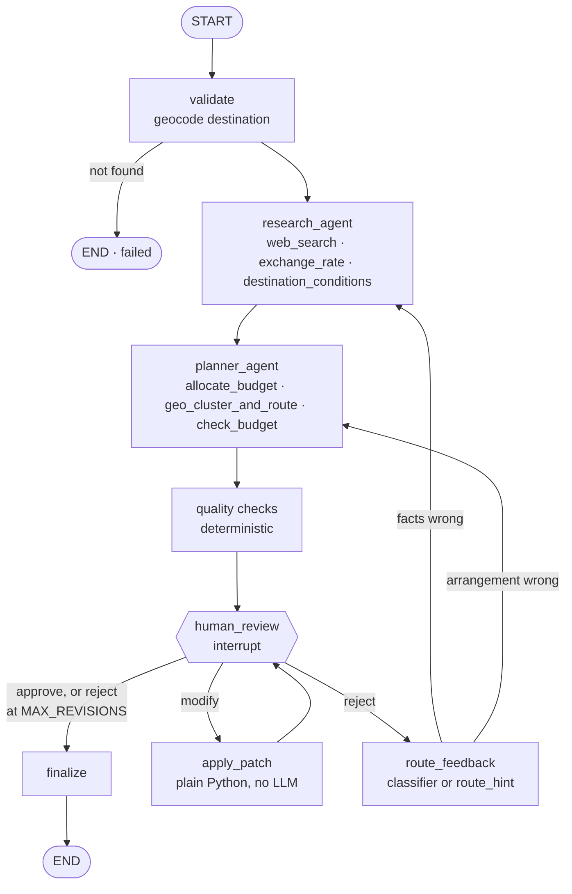

# AI Travel Planner

A multi-agent trip planner with a human approval gate. A **research agent** gathers facts (entry rules, prices,
weather, exchange rates, how to get there), a **planner agent** turns them into a budgeted, geographically sensible
day-by-day itinerary, and then the workflow **pauses for a human** who can approve it, reject it with feedback, or
edit it directly.

**LangGraph** runs the workflow, **FastAPI** is the control plane, and a dependency-free web app is served from the
same process. The pause is durable: state lives in a checkpointer (SQLite by default, Postgres optional), so a plan
waiting for review survives a restart, and `POST /plan` returns `202` immediately instead of holding a connection
open through minutes of LLM calls.

**Highlights**

- Human-in-the-loop review: approve, reject with routed feedback, or patch individual slots without an LLM call.
- Steering while it plans: send guidance mid-run and the app rewinds only as far as the guidance requires.
- Travellers from any country: visa rules, home currency with a real exchange rate, and localised search.
- Budget maths, dates and routing are computed in Python, never guessed by the model.
- Rotates across free LLM tiers (Gemini, OpenRouter, Groq) with a cooldown pool, so a spent quota doesn't stall plans.
- Crash recovery: plans cut off mid-run resume from their last completed step on startup.
- 227 offline tests (scripted LLM, mocked network) running the real graph, agents, checkpointer and API.

---

## Contents

- [Quick start](#quick-start)
- [How it works](#how-it-works)
- [Using it](#using-it)
- [Configuration](#configuration)
- [Deploying to production](#deploying-to-production)
- [Troubleshooting](#troubleshooting)
- [Development](#development)
- [Design decisions](#design-decisions)
- [Known limitations and roadmap](#known-limitations-and-roadmap)

---

## Quick start

**Requirements:** git, Python 3.11+, and [uv](https://docs.astral.sh/uv/)
(`curl -LsSf https://astral.sh/uv/install.sh | sh`, or `pip install uv`; Windows PowerShell:
`irm https://astral.sh/uv/install.ps1 | iex`).

```bash
# 1. Get the code
git clone https://github.com/prateek-srivastav/planny.git
cd planny

# 2. Configure keys (Windows: copy .env.example .env)
cp .env.example .env
#    Fill in at least one LLM key (GOOGLE_API_KEY, OPENROUTER_API_KEY or GROQ_API_KEY), ideally
#    all three, plus EXA_API_KEY. Leave the rest blank: models without a key are skipped.
#    One KEY=value per line: no quotes, no spaces around "=".

# 3. Install, then check every key with one real call each
uv sync
uv run python scripts/check_env.py

# 4. Run
uv run uvicorn app.main:app --reload
```

Open **http://localhost:8000/** for the web app or **http://localhost:8000/docs** for interactive API docs. A plan
takes roughly 2–5 minutes on free models; the UI shows the current stage, then the draft with review controls.

### Where to get keys

| Key | Used for | Free tier | Get it |
|---|---|---|---|
| `GOOGLE_API_KEY` | Gemini, the default agent model | Yes, no card | [aistudio.google.com/apikey](https://aistudio.google.com/apikey) |
| `OPENROUTER_API_KEY` | `:free` model fallbacks | Yes (50 req/day; 1,000/day after a one-time $10 top-up) | [openrouter.ai/settings/keys](https://openrouter.ai/settings/keys) |
| `GROQ_API_KEY` | Feedback/steering classifier, last-resort fallback | Yes | [console.groq.com/keys](https://console.groq.com/keys) |
| `EXA_API_KEY` (or `SERPER_API_KEY`) | Web search | Monthly free credit | [exa.ai](https://exa.ai) / [serper.dev](https://serper.dev) |

Weather (Open-Meteo), geocoding (Nominatim/OpenStreetMap) and exchange rates (Frankfurter/ECB) need no key.

### Which keys do I need?

**One LLM key is enough.** Keep the model lists from `.env.example` and fill in whichever keys you have: models whose
provider key is blank are skipped at startup (logged as `GROQ_API_KEY: not set, skipping …`). If `MODEL` itself has
no key, the first usable fallback becomes the main model, and a keyless `CLASSIFIER_MODEL` reuses the main model. The
server refuses to start only if no configured model has a key.

| Keys filled in | What you get |
|---|---|
| One LLM key | Works. No fallback: when that provider's free quota runs out, plans fail until it resets |
| Two or three LLM keys | Recommended. A spent quota or outage rolls over to the next provider |
| No `EXA_API_KEY` / `SERPER_API_KEY` | Plans still finish, but without web research (no entry rules, prices or sources); search is listed under `degraded` |

`scripts/check_env.py` reports which models will actually run and tests only those.

### No keys? Run the offline demo

```bash
uv run python scripts/offline_server.py      # http://127.0.0.1:8765
```

The same app with a scripted LLM and mocked network. The itinerary text is canned, but the API, status transitions,
human-review pause and checkpointing are the real code paths. Useful for exploring the API at no cost.

---

## How it works

### Workflow



1. **validate** geocodes the destination. An unknown place ends the plan as `failed` with a message.
2. **research_agent** searches the web and gathers entry requirements for the traveller's nationality, costs,
   transport from `origin`, an exchange rate, and weather.
3. **planner_agent** allocates the budget, clusters attractions into days by location, and builds the itinerary.
4. **Quality checks** move logistics out of activity slots, remove double-counted travel, and flag issues.
5. **human_review** pauses the graph with `interrupt()`. Nothing runs until a reviewer responds, however long
   that takes, including across restarts.

### Agents and tools

Both agents are `langchain.agents.create_agent` with typed output (`response_format=`), retry middleware for model
and tool calls, and per-run spend caps (`MAX_SEARCHES`, `MAX_AGENT_MODEL_CALLS`).

| Agent | Tool | What it does |
|---|---|---|
| research | `web_search` | Exa (page highlights in the same call) or Serper, behind a `SearchProvider` protocol, localised to the traveller's country. Returned URLs become the plan's `sources`. |
| research | `exchange_rate` | Frankfurter (ECB reference rates, ~30 currencies). The rate is attached to the draft by code, not typed by the model. |
| research | `destination_conditions` | Open-Meteo. A real daily forecast if the trip starts within 14 days; otherwise climatology from the same dates over the last 3 years, flagged `basis: historical_climatology`. |
| planner | `allocate_budget` / `check_budget` | Pure Python. Reserves intercity travel, splits the rest into per-category envelopes by destination price level, and checks planned spend. |
| planner | `geo_cluster_and_route` | Geocodes attractions, groups them into days with deterministic k-means, orders each day by nearest neighbour, and returns leg times, so days don't zig-zag across the city. |
| all | geocoding | Nominatim (throttled to 1 req/s, cached), ranked by importance ("Goa" is the Indian state, not Genoa), with Open-Meteo's geocoder as fallback. |

If a tool still fails after retries the run **continues** and the failure is listed in the plan's `degraded`
field: a weather outage produces a plan that says weather was unavailable, not a failed request.

### Human review

`human_review` calls `interrupt(payload, response_schema=ReviewDecision)`. The reviewer has three actions:

- **approve** → `finalize` builds the final plan (`status: approved`).
- **modify** → structured patches (`{op: replace|remove, day, slot, value}`) applied in Python, budget recomputed,
  straight back to review. Swapping one activity never re-rolls the trip.
- **reject** → `feedback` is required. If `route_hint` (`research` or `planner`) is given it is honoured; otherwise
  one small classifier call decides whether the facts or the arrangement are wrong. The chosen agent receives the
  feedback and the rejected draft and revises it rather than starting over. After `MAX_REVISIONS` rejections the plan
  finalizes with `status: needs_human_followup`.

### Draft quality checks

Every draft passes through [app/graph/quality.py](app/graph/quality.py) before review and after every edit:

- **Logistics are not activities.** Check-in/out, airport transfers and arrivals go in each day's `logistics` list,
  not a morning/afternoon/evening slot. Matching is deliberately narrow, so "São Bento Station" or "Day trip to
  Sintra" remain activities.
- **No double counting.** The trip to and from `origin` is costed once, in `intercity`; logistics items that restate
  it are removed.
- **`quality_issues`** tells the reviewer what to look at: places scheduled twice, empty mid-trip slots, lodging
  costed twice or missing a night, an origin with no travel planned, a total over the cap. These checks never change
  the plan.

### Steering while it plans

While a plan is still running, the traveller can send guidance (`POST /plan/{id}/steer`, or the box on the planning
screen). A small classifier labels the note with the **earliest stage it affects** and compares it with where the run
is:

| Guidance affects | Run is before that stage | In that stage | Past that stage |
|---|---|---|---|
| **request** (destination, dates, budget, party size, origin) | restart | restart | restart |
| **research** (diet, kinds of places, areas, accessibility, transport) | queued | live | rewind to research |
| **planner** (pacing, order, free time, budget split) | queued | live | — |

- **queued:** read into the prompt when that stage starts.
- **live:** `SteeringMiddleware` injects the note into the running agent's conversation before its next model call.
  A note that arrives after the agent's last call gets it one more round.
- **rewind:** the run is cancelled and re-run from the checkpoint taken just before that stage, so research isn't
  repeated for a pacing change.
- **restart:** the classifier returns a structured edit to the request, which is re-validated (`422` if, say, the new
  dates are in the past) and the plan restarts from `validate`.

Notes that reached an agent are saved in `PlanState.steering`, so revisions and retries still honour them. Once the
draft is ready, steering returns `409` and changes go through review. A client can skip the classifier by sending
`scope` itself.

### Travellers from any country

The traveller's `nationality` (a name, ISO code or demonym: `"India"`, `"BR"`, `"Kenyan"`) localises the plan:

- **Entry rules:** passport, visa and health requirements for that nationality, from official sources, carried on the
  draft as `entry_requirements` (or "not confirmed" rather than a guess). Always verify before booking.
- **Currency:** the budget defaults to the traveller's currency (India → `INR`, unknown → `USD`); `currency`
  overrides it. Local prices are converted with a real rate, shown on the draft as `exchange_rate`.
- **Search market:** Exa `userLocation` / Serper `gl` follow the traveller's country, so cost and booking research
  uses sources they would actually use.
- **Market notes:** country-specific prompt guidance lives in [app/core/markets.py](app/core/markets.py) (India has a
  detailed entry). Add a country by adding a key.

An unrecognised country still works; nothing is localised and currency falls back to `USD`. `GET /countries` lists
recognised ones. Preferences such as "vegetarian" or "travelling with parents" go in `notes`.

**Getting there:** set `origin` (e.g. `"Delhi"`) and research lists 1–3 round-trip options with per-person prices,
the planner picks one (`intercity` on the draft), and the budget reserves it before splitting the rest. Without
`origin`, only the stay is planned and budgeted.

### Persistence and recovery

- Every super-step is checkpointed (`durability="sync"`). Plan **status is derived from the checkpoint**, never
  stored separately: an error → `failed`; a pending interrupt → `awaiting_review`; finished with a final plan →
  `completed`; otherwise `running`.
- On startup, plans whose checkpoint says `running` (the process died mid-run) are re-invoked and continue from the
  last completed step (`RESUME_ORPHANS_ON_STARTUP`).
- A failed plan can be retried from the step that failed (`POST /plan/{id}/retry`), keeping earlier work.
- Checkpoint deserialization uses an explicit allowlist of domain models, so a checkpoint cannot instantiate
  arbitrary classes.

---

## Using it

### Web app

Served at `/` from [app/static/](app/static/) (no build step). Hash routes (`#/`, `#/plan/<id>`,
`#/plan/<id>/history`) make plans linkable. Screens:

- **New trip:** form with client-side validation that mirrors the API; server `422`s are mapped to fields.
- **Planning:** live stage, plus a "Steer this plan" box that reports whether guidance was applied live, queued,
  rewound or restarted.
- **Review:** budget ledger, getting there, entry rules, quality issues; edit/remove/add per slot (collected and sent
  as one `modify`), or request changes with routing.
- **Final:** approved or needs follow-up, with a print stylesheet. **Failed:** retry. **History:** checkpoint timeline.

Reviews are sent with the `checkpoint_id` they were made against; if the draft changed meanwhile, the `409` reloads
the latest version. Responsive down to 390 px and respects `prefers-reduced-motion`.

### API

| Method | Path | Result |
|---|---|---|
| `POST` | `/plan` | `202` `{plan_id, status, links}`; planning runs in the background |
| `GET` | `/plan/{id}` | Status, stage, draft and, when paused, the review payload plus the JSON Schema for the review body |
| `POST` | `/plan/{id}/review` | `202`. `409` unless `awaiting_review` or the `checkpoint_id` is stale; `422` on a bad body |
| `POST` | `/plan/{id}/steer` | `202` `{action: queued\|live\|rewind\|restart, scope, reason, …}`; `409` once the draft is ready |
| `POST` | `/plan/{id}/retry` | `202`. Re-runs a **failed** plan from the failed step (`409` otherwise) |
| `GET` | `/plan/{id}/final` | `200` final plan, or `409` with the current status |
| `GET` | `/plan/{id}/events` | Server-Sent Events: status/stage changes until the plan needs a human, finishes or fails |
| `GET` | `/plan/{id}/history` | Checkpoint timeline |
| `GET` | `/countries` | Countries with a known currency and search market |
| `GET` | `/healthz` | Liveness probe |

`status` is one of `running`, `awaiting_review`, `completed`, `failed`. Requests are validated by Pydantic
(`end_date > start_date`, start not in the past, trip ≤ 30 days, `budget_max ≥ budget_min > 0`, `travelers ≥ 1`;
optional `nationality`, `currency`, `origin`, `interests`, `notes`) and return `422` with field detail. Full schemas
are at `/docs`.

### Example session

Against the offline demo (`scripts/offline_server.py`); with the real server use port 8000.

```text
$ curl -i -X POST localhost:8765/plan -H 'content-type: application/json' -d '{
    "destination":"Lisbon","start_date":"2026-10-14","end_date":"2026-10-17",
    "budget_min":1500,"budget_max":2000,"travelers":2,"interests":["food","history"]}'
HTTP/1.1 202 Accepted
{"plan_id":"4222f8f9…","status":"running","links":{"self":"/plan/4222f8f9…","review":"…/review", …}}

$ curl localhost:8765/plan/4222f8f9…
{ "status":"awaiting_review", "stage":"awaiting review", "checkpoint_id":"1f1c4061-8fc9-…",
  "draft":{ "title":"Lisbon trip", "days":[…4 days…],
            "budget":{"cap":2000.0,"total_estimated":1420.0,"remaining":580.0,"within_budget":true,
                      "by_category":{"lodging":600.0,"food":360.0,"activities":400.0,"transit":60.0}},
            "sources":[{"title":"Lisbon guide","url":"https://example.com/lisbon-guide"}] },
  "review":{ "payload":{"revisions_used":0,"revisions_left":3,"degraded":[], …},
             "response_schema":{ …JSON Schema for the review body… } } }

$ curl -X POST localhost:8765/plan/4222f8f9…/review -d '{"action":"reject"}'
{"detail":[{"msg":"Value error, feedback is required when action=reject", …}]}            # 422

$ curl -X POST localhost:8765/plan/4222f8f9…/review -d '{"action":"approve"}'              # 202
$ curl localhost:8765/plan/4222f8f9…/final
{"status":"approved","revisions":0,"degraded":[],"itinerary":{…},"finalized_at":"2026-10-09T17:23:18Z"}

$ curl -N localhost:8765/plan/<id>/events
data: {"status":"running","stage":"drafting itinerary","checkpoint_id":"…"}
data: {"status":"awaiting_review","stage":"awaiting review","checkpoint_id":"…"}
```

Edit a slot instead of approving, conditional on the draft you reviewed:

```bash
curl -X POST localhost:8000/plan/$ID/review -H 'content-type: application/json' -d '{
  "action":"modify", "checkpoint_id":"<from GET /plan/{id}>",
  "patches":[{"op":"replace","day":2,"slot":"afternoon",
              "value":{"name":"Fado show in Alfama","est_cost":120}}]}'
```

Reject and send it straight to the planner:

```bash
curl -X POST localhost:8000/plan/$ID/review -H 'content-type: application/json' \
  -d '{"action":"reject","feedback":"Day 3 is too packed","route_hint":"planner"}'
```

---

## Configuration

All settings are environment variables, read from `.env` next to the code (see [.env.example](.env.example)). The app
finds that `.env` wherever it is started from. Settings are read once at startup: restart after changing them.

**Models**

| Variable | Default | Notes |
|---|---|---|
| `MODEL` | `anthropic:claude-sonnet-5-5` (`.env.example`: `google_genai:gemini-3.8-flash`) | Research and planner agents. Needs tool calling, long context and large structured output. Format `provider:model-id`; providers `google_genai`, `openrouter`, `groq`, `anthropic`, `openai` |
| `MODEL_FALLBACKS` | – | Comma-separated, tried in order when `MODEL` fails. Models without a key are skipped; if `MODEL` has none, the first usable fallback replaces it |
| `MODEL_COOLDOWN_SECONDS` | `300` | How long a failed model is benched before being tried again |
| `MODEL_QUOTA_COOLDOWN_SECONDS` | `3600` | Longer bench for a spent daily quota |
| `CLASSIFIER_MODEL` | `MODEL` | One small call per rejection or steering note. Falls back to the main model if its key isn't set |
| `OPENROUTER_FALLBACK_MODELS` | – | OpenRouter's own server-side fallback list for `MODEL` |
| `GOOGLE_API_KEY`, `OPENROUTER_API_KEY`, `GROQ_API_KEY`, `ANTHROPIC_API_KEY`, `OPENAI_API_KEY` | – | At least one for a configured model; the rest are optional |
| `GOOGLE_RPM`, `OPENROUTER_RPM`, `GROQ_RPM` | `10` / `18` / `25` | Client-side request caps just under the free limits; raise with paid credit |
| `GROQ_REASONING_EFFORT` | `low` | For gpt-oss classifier calls |

**Search and tools**

| Variable | Default | Notes |
|---|---|---|
| `SEARCH_PROVIDER` | `exa` | `exa` or `serper` |
| `EXA_API_KEY` / `SERPER_API_KEY` | – | Search degrades (recorded in `degraded`) if missing |
| `SEARCH_COUNTRY` | – | ISO code; fallback market when the nationality isn't recognised |
| `SEARCH_NUM_RESULTS`, `SEARCH_RESULT_CHARS` | `4`, `600` | Size of each search result kept in the agent's context |
| `NOMINATIM_URL` | public OSM instance | Point at your own Nominatim for higher throughput |
| `HTTP_USER_AGENT` | `planny/0.1 (+https://github.com/prateek-srivastav/planny)` | Required by Nominatim's usage policy; set it to identify your deployment |

**Workflow and limits**

| Variable | Default | Notes |
|---|---|---|
| `MAX_REVISIONS` | `5` | Rejections before the plan finalizes as `needs_human_followup` |
| `MAX_SEARCHES` | `6` | Per agent run; further searches tell the agent to finish |
| `MAX_AGENT_MODEL_CALLS` | `16` | Per agent run; a hard stop that fails the plan rather than burning quota |
| `RETRY_INITIAL_DELAY` | `2.0` | Backoff base (seconds) for model/tool retries |
| `RESUME_ORPHANS_ON_STARTUP` | `true` | Resume plans interrupted by a crash or restart |

**Persistence**

| Variable | Default | Notes |
|---|---|---|
| `SQLITE_PATH` | `data/checkpoints.sqlite` | Relative to the working directory |
| `POSTGRES_URL` | – | Setting it switches the backend to Postgres (install with `uv sync --extra postgres`) |

### Choosing models on free tiers

One plan is roughly 10–25 model calls. Limits as of October 2026:

| Provider | Limit that matters | Best use |
|---|---|---|
| Google AI Studio (Gemini Flash) | Per-model quotas (each model has its own) | Primary agent model: best free itinerary quality in testing. Free-tier data may be used by Google to improve its products |
| OpenRouter `:free` models | 20 req/min; **50 req/day account-wide** (1,000/day after a one-time $10 top-up) | Agent fallbacks; free models rotate, so keep several |
| Groq | 30 req/min, 1,000 req/day, **8K tokens/min** | The classifier. Fine for research, but returned malformed itineraries in testing, so it stays last |

In a planner-sized test (one complete 3-day itinerary in the real schema, 11 Oct 2026), Gemini 3.8 Flash and 3.5 Flash
filled 9/9 activity slots, OpenRouter `nemotron-3-super` 7/9, and Groq models failed. The `.env.example` chain
alternates providers in that quality order so a spent quota moves straight to the next provider. The `ModelPool`
([app/core/model_pool.py](app/core/model_pool.py)) benches failed models for all agents and plans, so a dead model
isn't retried on every call.

---

## Deploying to production

### Docker

```bash
docker compose up --build                       # SQLite on a named volume
docker compose --profile postgres up --build    # also starts Postgres; set POSTGRES_URL in docker-compose.yml
```

The image installs the Postgres extra, runs `uvicorn` on port 8000, and has a `HEALTHCHECK` on `/healthz`. Keys come
from `.env` via `env_file`; the file is not copied into the image.

Without Docker:

```bash
uv sync --frozen --no-dev --extra postgres
uv run uvicorn app.main:app --host 0.0.0.0 --port 8000 --proxy-headers
```

### Production checklist

The app is a single-process service. These are required before exposing it to users:

- [ ] **Run exactly one worker.** Plan runs are asyncio tasks inside the API process and the "one run per plan"
      guard is in memory. Do not use `--workers > 1` or multiple replicas against the same database. Scale
      vertically.
- [ ] **Put authentication in front of it.** The API has no auth, per-user scoping or rate limiting, and every plan
      spends LLM and search quota. Use a reverse proxy or gateway (OAuth2 proxy, Cloudflare Access, API gateway)
      with per-client rate limits.
- [ ] **Use Postgres** (`POSTGRES_URL`) for anything beyond a single host, with backups. If you stay on SQLite, keep
      `SQLITE_PATH` on a persistent volume and back it up.
- [ ] **Terminate TLS at the proxy** and disable response buffering for `/plan/*/events` (nginx:
      `proxy_buffering off;`, with a read timeout of several minutes) so Server-Sent Events stream.
- [ ] **Allow graceful shutdown.** Give the container a stop grace period; in-flight runs are cancelled on
      shutdown and resumed on the next start.
- [ ] **Keep secrets out of the image** (env vars or a secret manager) and run `scripts/check_env.py` against the
      production environment once before go-live.
- [ ] **Set `HTTP_USER_AGENT`** to identify your deployment and contact, per Nominatim's usage policy. For real
      traffic, self-host Nominatim (`NOMINATIM_URL`); the public instance allows 1 req/s.
- [ ] **Use paid model tiers or raise the RPM caps** to match your quotas; free tiers allow only a few plans a day.
- [ ] **Monitor** `/healthz`, plans stuck in `running`, entries in `degraded`, and provider spend. Logs go to stdout.
- [ ] **Plan for data growth:** finished plans are never deleted; prune old checkpoint threads periodically.
- [ ] **Run the container as a non-root user** if your platform requires it (the provided Dockerfile runs as root;
      the data volume must be writable by the chosen user).

---

## Troubleshooting

`uv run python scripts/check_env.py` diagnoses `.env` first (file found? key empty, duplicated, a placeholder, another
provider's key, a misspelled name, or overridden by a shell variable?), checks key formats, then makes one real call
per provider. Keys are always masked. The server logs the same key report at startup.

| You see | Meaning | Fix |
|---|---|---|
| `UnauthorizedResponseError: Missing Authentication header` | OpenRouter received something that isn't key-shaped: empty, a placeholder, another provider's key (`gsk_…` is Groq's, a UUID is Exa's) or a key wrapped in quotes | The line must be exactly `OPENROUTER_API_KEY=sk-or-v1-…` |
| `UnauthorizedResponseError: User not found` | Right shape, but revoked or mistyped | Create a new key |
| `OPENROUTER_API_KEY: not set, skipping …` | No key for that provider, so its models are left out (fine if you meant it) | Add the key to `<project>/.env` to use them |
| `ConfigError: no API key is set for any configured model` | None of the models in `MODEL` / `MODEL_FALLBACKS` has a key | Set at least one of the named keys |
| Fixed `.env`, still failing | Settings are read once at startup | Restart the server, then **Retry** the plan |
| Error ends with *daily quota is used up* | OpenRouter free models share one 50/day cap | Keep Gemini/Groq in `MODEL_FALLBACKS`; spent models are skipped |
| `.env diagnosis` says *shell also exports it* | An exported variable beats the file. An obviously invalid exported value is ignored in favour of a valid `.env` key (with a warning); a valid exported key still wins | Remove the stale line from your shell profile and open a new terminal |
| Open-Meteo `429` or timeout | Shared free-tier limits | Harmless: weather degrades to "unavailable" in the plan |
| Port 8000 in use | – | `--port 8001` |
| Want a clean slate | – | Stop the server and delete `data/checkpoints.sqlite*` |

---

## Development

### Project layout

```text
app/
  main.py              App factory and lifespan: checkpointer, HTTP client, graph, orphan recovery
  api/                 FastAPI routes, request/response schemas, status derivation, run runtime
  core/                Settings, LLM factory and ModelPool, checkpointer, countries/markets, .env doctor
  graph/
    build.py           StateGraph wiring
    nodes.py           validate, agent wrappers, human_review, apply_patch, route_feedback, finalize
    state.py           PlanState and domain models (itinerary, budget, review decision)
    quality.py         Deterministic draft checks
    steering.py        SteeringDesk inbox, classifier and middleware
    agents/            Research and planner agents, spend limits
  tools/               Search, geocoding/clustering, weather, FX, budget, tool registry
  static/              Web client (index.html, app.css, app.js)
scripts/
  check_env.py         Key diagnosis and live checks
  offline_server.py    Demo server with scripted LLM and mocked network
tests/                 Offline test suite; fakes.py holds the scripted model and mocked transport
```

### Tests and linting

```bash
uv run pytest -q                                   # 227 tests, fully offline, ~5 s
uv run ruff check . && uv run ruff format --check .
POSTGRES_TEST_URL=postgresql://user@host/db uv run pytest tests/test_persistence.py   # opt-in Postgres test
```

The LLM is a scripted `BaseChatModel` and the network is an `httpx.MockTransport`; the real `create_agent` loops,
tools, graph, checkpointer and FastAPI app all run. Tests never read your `.env`. Highlights:

- `test_persistence.py`: pause → tear everything down → rebuild from the same DB file → resume; a run cancelled
  mid-research is resumed on startup; Postgres variant.
- `test_graph_hitl.py`: approve, modify, reject to planner or research, `route_hint`, classifier failure, revision
  cap, unknown destination, search/weather outages.
- `test_api.py`: `202` doesn't wait for agents, full flow, `409`/`422`/`404` cases, SSE, history.
- `test_steering.py`: the queued/live/rewind/restart rule, including notes arriving mid-stage.
- `test_quality.py`, `test_tools.py`, `test_model_pool.py`, `test_auth_errors.py`, `test_envdoc.py`: checks, tools,
  fallback rotation, key diagnosis.

CI ([.github/workflows/ci.yml](.github/workflows/ci.yml)) runs ruff and the test suite on every push and pull
request.

### Verification status

- **Offline:** the full test suite, including the Postgres backend end to end against Postgres 16.
- **Live, end to end:** a Lisbon plan (4 days, 2 travellers) with an OpenRouter free model, Groq routing, Exa,
  Open-Meteo and Nominatim reached review in about 4 minutes; a rejection was routed to the planner and fixed;
  approval produced a final plan that survived a server restart.
- **Live, component level:** tool calling for every model in the example chain, strict-schema routing on Groq,
  OpenRouter → Groq rollover, Exa highlights, Frankfurter rates.
- **Docker:** the image builds and starts; the container reports `healthy`, and `/healthz`, the web app, `/docs`,
  `/countries` and request validation respond, with SQLite written to the mounted volume.
- **Not yet verified live:** a full plan with the any-country prompts, Open-Meteo climatology (mocked tests only),
  and a full plan inside the container.

---

## Design decisions

Each is *decision → alternative → why*.

1. **Status is derived from the checkpoint, never stored.** *Alternative: a `plans` table with a status column.*
   That is a second source of truth that drifts from the real workflow position. The only non-checkpoint input is
   whether a run task is alive in this process, used to avoid reporting `awaiting_review` the instant after a review
   is accepted.
2. **`POST /plan` returns 202 and runs detached.** *Alternative: block until the draft is ready.* Blocking dies
   behind proxy timeouts. The request is written to the first checkpoint before returning, so `GET` works the moment
   the `202` lands. Runs use a small `RunManager` of asyncio tasks rather than `BackgroundTasks`, which run before
   the response under an ASGI test transport and would make this untestable.
3. **Explicit `StateGraph`, not a supervisor with handoffs.** The workflow is a deterministic pipeline with a gate.
   The one model-chosen route (`route_feedback`) is a single structured call with a human override.
4. **Modify is a deterministic patch.** A one-slot swap shouldn't re-roll the trip, and the budget re-check must be
   arithmetic. Budget totals, dates and day numbers are always computed in Python.
5. **`human_review` contains only `interrupt()` and a routing decision.** LangGraph re-runs a node from its first line
   on resume, so side effects live in `finalize`, and looping is done with graph edges.
6. **Failures are written into state.** A crash in an agent node becomes `error` in the checkpoint, so status can
   see it and Retry can fork from the failed step.
7. **Agents are called from wrapper nodes** rather than embedded as subgraphs, so prompts can include feedback, the
   previous draft and steering notes, and tool side-data (sources, weather, degradations) can be collected.
8. **Search behind a protocol, Exa by default.** Exa returns relevant page text in the same call, so one tool call
   replaces search-then-scrape.
9. **A shared model pool with cooldowns** instead of LangChain's stateless fallback middleware, which would retry a
   spent daily quota first on every call. Retry middleware uses `on_failure="error"` so failures reach the pool.
10. **Steering rewinds only to the earliest affected stage.** Restarting wastes research for a pacing tweak; passing
    every note to the current agent is wrong when the planner is working from research that ignored a dietary need.
    Checkpoints already mark where each stage began, so a rewind is a fork, not a new mechanism.

Two LangGraph behaviours shaped the code: `Command(goto=END)` doesn't cancel a static outgoing edge (so nodes that
can fail route only with `Command`), and inner agents run with `durability="async"` because an agent without a
checkpointer inside a `durability="sync"` parent crashes in LangGraph 1.2.14.

---

## Known limitations and roadmap

**Limitations**

- Single process: see the [production checklist](#production-checklist). Startup recovery resumes interrupted runs
  but doesn't make multiple workers safe.
- No auth, per-user scoping or rate limiting in the app itself. A rejected-and-revised plan spends search credit
  each time.
- Prices are model estimates from search results, not live quotes. No booking or payments.
- Forecasts cover 14 days; later trips get climatology. Nominatim's 1 req/s limit makes clustering ~12 places take
  ~12 s.
- Finished plans are never cleaned up.
- Steering notes not yet delivered to an agent live in memory and are lost on restart. A rewind cancels the in-flight
  model call, but the provider may still bill for it.
- The feedback and steering classifiers are single unvalidated calls; there is no eval harness for itinerary quality.

**Assumptions:** one reviewer per plan; budget is for the whole party in one currency with `budget_max` as the cap;
English only.

**Roadmap:** queue-backed workers (arq or Temporal) with a Postgres advisory lock for cross-worker exclusion;
checkpoint TTL for finished plans; auth and per-user plans; idempotency keys on `POST /plan`; per-plan cost
ceilings; LangSmith tracing and an eval set for budget adherence and geographic coherence; a durable steering inbox;
streaming draft tokens.
